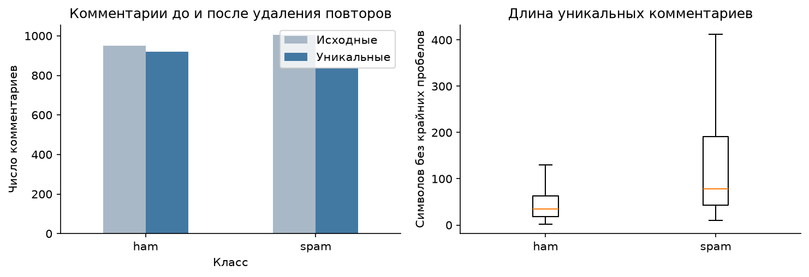
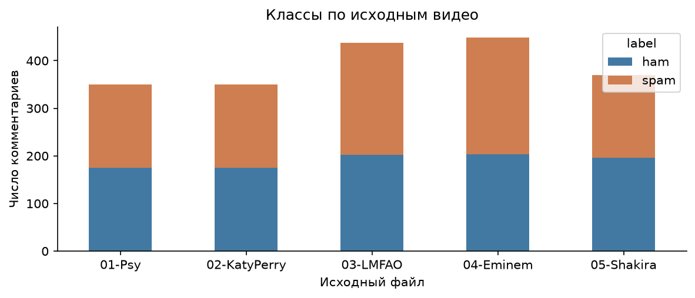
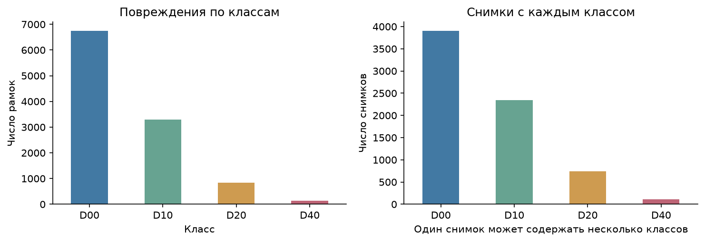
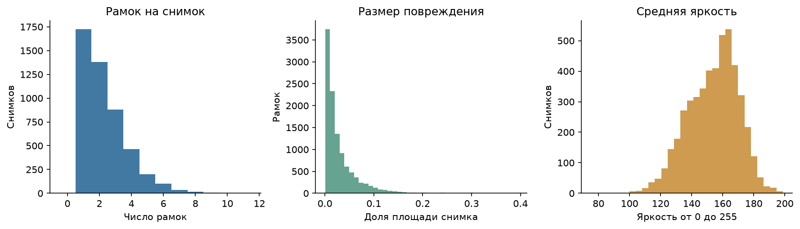
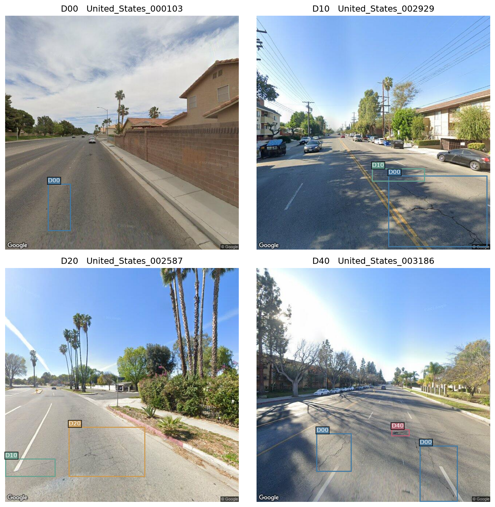

# Начальный анализ исходных датасетов

Первая самостоятельная работа от 21.10.2026. Исследованы YouTube Spam Collection и американская часть RDD2022 train. Это результаты до обогащения.

## YouTube Spam Collection

- Исходных комментариев: 1956; spam — 1005, ham — 951.
- Пропусков текста: 0; пустых текстов после strip: 0; неизвестных меток: 0.
- Повторных строк по точному тексту после strip: 197; конфликтующих меток у одинаковых текстов: 0.
- Уникальных текстов: 1759; ham — 919, spam — 840. Предварительный манифест: 1500 текстов, по 750 на класс, seed 42.
- Текстов с URL: 202, с HTML: 106. Медианная длина уникального ham — 35 символов, spam — 78. Наличие ссылки само по себе не является инструкцией разметки.

## RDD2022 United States

Проверены все 4805 обучающих снимков и 4805 XML-файлов этой части. В официальном test есть ещё 1200 снимков без открытой разметки. Эти числа не относятся ко всем шести странам RDD2022.

| Класс | Рамок | Снимков с классом |
|---|---:|---:|
| D00 продольные трещины | 6750 | 3907 |
| D10 поперечные трещины | 3295 | 2342 |
| D20 сетчатые трещины | 834 | 739 |
| D40 выбоины | 135 | 116 |

Всего 11014 рамок. Один снимок может содержать несколько классов, поэтому числа снимков в строках не суммируются в общий объём.

- Все снимки прочитаны; размер каждого 640 × 640 совпадает с XML.
- Некорректных рамок: 0; неизвестных классов: 0; повторных рамок: 0.
- Повторов изображений по пикселям: 1. Точных совпадений train с официальным test: 1.
- dHash выявил 28 пар кандидатов на близкие повторы. Они требуют визуального подтверждения; автоматически дублями не объявляются.
- Для предварительного манифеста из 3000 снимков доступны 4803 уникальных валидных изображений без точного совпадения с официальным test. Все четыре класса присутствуют. Готового разбиения для обучения пока нет.

Иллюстрации: RDD2022, Arya и соавторы, CC BY 4.0. Добавлены исходные рамки и подписи. Изучается детекция, не классификация изображения целиком.

## Ограничения и дальнейшие решения

Выбоины составляют 1.23% рамок американской части. Нужно проверять качество по каждому классу, а не только общую метрику. Новая съёмка может отличаться от Google Street View; необходимо контролировать ракурс, освещение и происхождение. Японская часть не используется в этой исходной выборке из-за описанной авторами истории GAN-аугментации в предшествующем RDD2019.

Точные повторы исключаются до разбиения. Близкие кадры и производные одного примера должны оставаться в одной группе. Для текста предстоит проверка близких и шаблонных повторов; для снимков — просмотр кандидатов dHash и определение групп участков дороги.

После реального сбора и синтеза будет выполнен аналогичный анализ после обогащения. Сейчас нет результатов ручной разметки, FID, обучения или сравнения четырёх вариантов.

## Воспроизведение и источники

- Выполненный [ноутбук](https://github.com/amakedoni/frame/blob/main/notebooks/01_initial_eda.ipynb).
- Метрики: `reports/eda_summary.json`; профили и манифесты: `data/processed/`.
- [YouTube Spam Collection UCI](https://archive.ics.uci.edu/dataset/380/youtube+spam+collection), CC BY 4.0.
- [RDD2022 Figshare](https://figshare.com/articles/dataset/RDD2022_-_The_multi-national_Road_Damage_Dataset_released_through_CRDDC_2022/21431547), CC BY 4.0.
- [Статья авторов RDD2022](https://arxiv.org/pdf/2209.08538).
- [Репозиторий авторов](https://github.com/sekilab/RoadDamageDetector).

Дата проверки источников: 21.10.2026. Версии библиотек и логи исполнения сохранены в репозитории.
