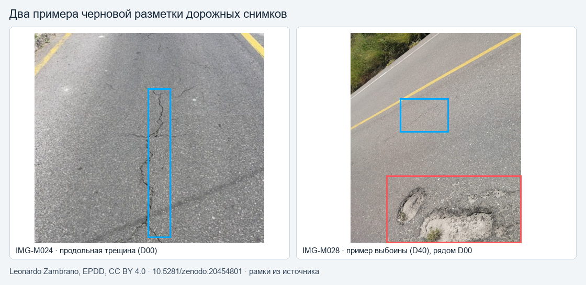

# Этап 18 ноября: новые данные и черновая разметка

К встрече 18 ноября готовы [codebook 0.1](../docs/annotation_codebook.md) и [порядок проверки](../docs/november_review.md). Александр сообщил, что просмотрел черновые метки и рамки. Итоговый ручной набор, два независимых экспорта и измеренное время аннотаторов пока отсутствуют.

| Материал | Размер черновика | Откуда взялась разметка |
| --- | ---: | --- |
| Музыкальные комментарии YouTube | 83 текста, 61 `ham` и 22 `spam` в черновике | Черновые метки сохранены отдельно от заданий для независимой разметки |
| Дорожные снимки | 60 снимков, 197 рамок | Опубликованные YOLO-рамки EPDD, переведённые в формат Label Studio |
| Две независимые разметки на одном ID | 0 объектов | Чистые проекты обоих участников подготовлены; ответы пока не отправлены |

| Класс дорожного повреждения | Снимки с этим классом | Рамки |
| --- | ---: | ---: |
| D00, продольная трещина | 38 | 63 |
| D10, поперечная трещина | 18 | 27 |
| D20, сетка трещин | 26 | 37 |
| D40, выбоина | 34 | 70 |

Снимок может содержать несколько классов. Числа относятся к предразметке. Итоговое покрытие нужно пересчитать после двух независимых проходов и согласования спорных случаев. Цель 50–100 новых экземпляров на класс или обоснованная пропорция пока не подтверждена.

Иллюстрация: снимки **IMG-M024** и **IMG-M028**, Leonardo Zambrano, [Ecuador Pavement Damage Dataset, Zenodo](https://doi.org/10.5281/zenodo.20454801), [CC BY 4.0](https://creativecommons.org/licenses/by/4.0/). Изображения уменьшены, поверх нанесены рамки из предразметки и добавлены подписи. Наши обозначения классов соответствуют codebook; рамки требуют проверки.

## Новизна и происхождение данных

- **Текст:** [YT‑100K](https://huggingface.co/datasets/hridaydutta123/YT-100K), Hridoy Sankar Dutta и Biswadeep Khan, DOI `10.57967/hf/3602`. Карточка источника указывает CC BY 4.0. Проверено отсутствие точных повторов текста с базовым UCI и внутри выбранной партии. Тексты и персональные поля в опубликованный комплект не входят.
- **Изображения:** Leonardo Zambrano, EPDD, DOI `10.5281/zenodo.20454801`, CC BY 4.0. Проверены точные и близкие совпадения с американской обучающей частью исходного RDD2022; шесть кадров исключены по предварительному просмотру из-за слабой видимости или подозрения на повторы. Это не проверка по всем шести странам RDD. Собственных фотографий пока нет.
- Для просмотра предусмотрены отдельные проекты с черновыми метками и рамками. Для двойной разметки оба участника используют одинаковые задания, сохраняют собственные ответы и сверяют общие ID после экспорта.

Рабочие файлы и архив для показа хранятся локально. В репозитории опубликованы инструкции, пример дорожных рамок с атрибуцией, агрегаты и код обработки. [Инструкция к встрече](../docs/november_defense.md).
