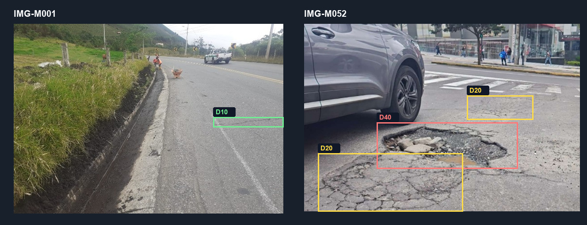

# Источники пилота

| Материал | Объём | Источник |
| --- | ---: | --- |
| Комментарии к музыкальным видео | 60 | [YT‑100K](https://huggingface.co/datasets/hridaydutta123/YT-100K), Hridoy Sankar Dutta и Biswadeep Khan |
| Дорожные фотографии | 60 | [Ecuadorian Pavement Distress Dataset (EcuPDD)](https://doi.org/10.5281/zenodo.20454801), Leonardo Zambrano, CC BY 4.0 по [статье авторов](https://www.frontiersin.org/journals/built-environment/articles/10.3389/fbuil.2026.1895873/full) |

В выбранных комментариях проверили точные совпадения с исходным YouTube Spam Collection. Фотографии сравнили по хешам с американской обучающей частью RDD2022 и просмотрели подозрительно похожие ракурсы. Источники, даты обращения и хеши записаны в манифестах архива пилота. Объём ручного обогащения по классам оценивается отдельно.

## Примеры рамок из прохода A

Фотографии Leonardo Zambrano, [EcuPDD](https://doi.org/10.5281/zenodo.20454801), [CC BY 4.0](https://creativecommons.org/licenses/by/4.0/). Фотографии уменьшены, поверх нанесены рамки и коды классов из прохода A.
